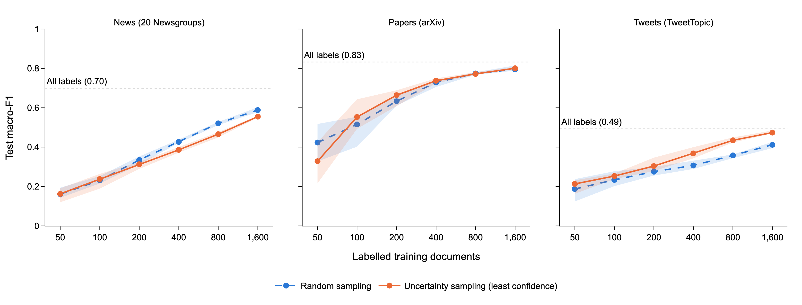
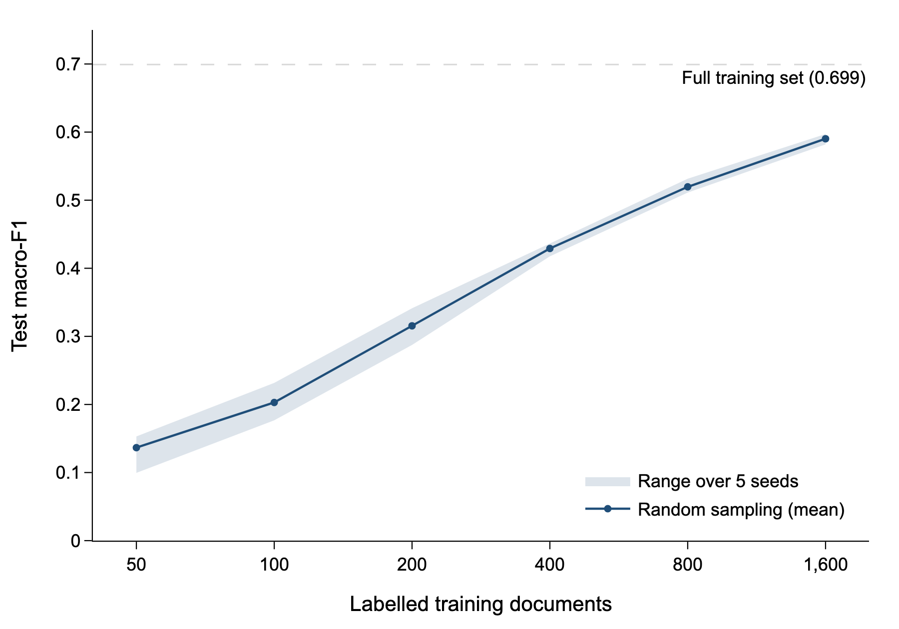

# Active learning for topic classification: how many labels does uncertainty sampling save?

> [!WARNING]
> **Work in progress.** The core experiment (uncertainty vs random sampling on news, papers and tweets) has results. The preprocessing and model comparisons and the classification demo are still being built. Numbers and code may change.

Labelling text is the expensive part of building a classifier. This project asks:

> **Does uncertainty sampling reach the same accuracy with fewer labels than random sampling, and does that saving hold across domains — news, academic papers and social media posts?**

The setup follows [Small-Text](https://github.com/webis-de/small-text) (Schröder et al., 2021): pool-based active learning with a TF-IDF + linear SVM classifier, compared against random sampling on learning curves of increasing label budgets.

**Hypothesis.** Both strategies converge at very small budgets (too little signal) and at large budgets (enough labels either way). In between, uncertainty sampling should sit above random, giving a larger area under the learning curve.

## Status

| Phase | Domain | Status |
|---|---|---|
| Full-data baseline | News, papers, tweets | Done |
| Random-sampling learning curve | News | Done |
| Uncertainty vs random sampling learning curves | News, papers, tweets | Done |
| Preprocessing comparison (raw / stop words removed / stemmed / lemmatised) | News | Planned |
| Model comparison (Naive Bayes / logistic regression / linear SVM) | News | Planned |
| Classification demo for new documents | News | Planned |

## Main result: the saving depends on the domain



Test macro-F1 against the number of labelled documents (log scale). Lines are means over 5 seeds, bands are min–max. Each seed starts from the same balanced cold start (2 documents per class) for both strategies, then queries batches of 10. The dotted line is the same classifier trained on every training document.

Labels each strategy needs to match random sampling's mean macro-F1 at 1,600 labels (log-interpolated between budgets; lower is better):

| Strategy | News | Papers (arXiv) | Tweets |
|---|---|---|---|
| Random sampling | 1,600 | 1,600 | 1,600 |
| Least confidence | not reached | 1,403 | **632** |
| Prediction entropy | not reached | 1,304 | 708 |
| Breaking ties | not reached | **841** | 900 |

Mean macro-F1 at 400 labels (seeds out of 5 where the strategy beat random with the same cold start):

| Strategy | News | Papers (arXiv) | Tweets |
|---|---|---|---|
| Random sampling | **0.427** | 0.729 | 0.307 |
| Least confidence | 0.386 (0/5) | 0.737 (3/5) | **0.368** (5/5) |
| Prediction entropy | 0.392 (0/5) | 0.733 (3/5) | 0.365 (5/5) |
| Breaking ties | 0.440 (4/5) | **0.758** (5/5) | 0.337 (5/5) |

- **Tweets:** uncertainty sampling wins clearly. Least confidence reaches random's 1,600-label score with about 630 labels, and beats random in every seed from 400 labels on. A likely reason (not yet tested): TweetTopic is heavily imbalanced (24:1), so querying uncertain tweets may find rare-class examples that random sampling misses.
- **Papers:** breaking ties roughly halves the labels needed (841 vs 1,600) and wins in 5/5 seeds from 100 to 800 labels. Least confidence and entropy help only a little, and lose at 50 labels.
- **News:** least confidence and entropy are **worse** than random from 200 labels on (0/5 seeds at 400–1,600). Breaking ties is level with random. The hypothesis fails here.

Full per-budget numbers: [`results/al_summary.csv`](results/al_summary.csv).

## Data

| | News | Papers | Tweets |
|---|---|---|---|
| Dataset | 20 Newsgroups | `ccdv/arxiv-classification` (`no_ref`) | `cardiffnlp/tweet_topic_single` (`coling2022` split) |
| Training pool | 11,014 | 28,388 | 3,598 |
| Test | 7,317 | 2,500 | 3,399 |
| Classes | 20 | 11 | 6 |
| Median length (whitespace tokens, train) | 86 | 8,424 | 25 |
| Imbalance ratio (largest ÷ smallest class, train) | 1.64 | 1.67 | 24.2 |
| Full-data macro-F1 / accuracy | 0.699 / 0.711 | 0.833 / 0.840 | 0.493 / 0.755 |

20 Newsgroups uses the standard by-date split with headers, footers and quoted replies removed, so the model cannot read the newsgroup name or a signature instead of the text. The arXiv `no_ref` config drops reference lists for the same reason. TweetTopic's `coling2022` split is temporal: test tweets are later than training tweets. In all three, documents left empty are dropped: they would be all-zero vectors that uncertainty sampling queries first and learns nothing from.

Metric: **macro-F1** (every class weighted equally), with accuracy reported alongside. On tweets the gap between the two (0.49 vs 0.76) is the class imbalance at work.

## Earlier result: random-sampling curve on 20 Newsgroups

The first learning curve, with an unbalanced random cold start, 5 seeds per budget:



| Labels | Mean macro-F1 | Range over seeds |
|---|---|---|
| 50 | 0.137 | 0.099–0.153 |
| 100 | 0.203 | 0.177–0.232 |
| 200 | 0.316 | 0.287–0.341 |
| 400 | 0.429 | 0.418–0.437 |
| 800 | 0.520 | 0.511–0.532 |
| 1,600 | 0.590 | 0.582–0.597 |

## Reproduce

```bash
conda create -n nlp python=3.11
conda activate nlp
pip install -r requirements.txt

python -m src.data.domains                 # dataset statistics (downloads into data/)
python -m src.core.baseline                # 20NG full-data baseline -> results/baseline_20ng.json
python -m src.core.random_curve            # 20NG random curve       -> results/random_curve_20ng.csv
python experiments/plot_random_curve.py    # -> figures/random_curve_20ng.{html,png}

python -m experiments.full_baselines       # full-data ceiling per domain -> results/full_baseline_<domain>.json
python -m experiments.al_curves news arxiv tweets --jobs 4   # -> results/al_curve_<domain>.csv (arXiv takes ~1 h)
python -m experiments.summarise_al         # -> results/al_summary.csv
python experiments/plot_al_curves.py       # -> figures/al_curves.{html,png}
```

All runs use fixed seeds (0–4 for the learning curves, 42 for the baselines); every number above comes from a file in `results/`.

## Repository layout

```
src/data/      dataset loading and preprocessing
src/core/      classifier, sampling strategies and active-learning logic
experiments/   experiment, summary and plotting scripts
results/       raw outputs (CSV/JSON), one file per run
figures/       generated figures
```

## Reference

Schröder, C., Müller, L., Niekler, A., & Potthast, M. (2021). *Small-Text: Active Learning for Text Classification in Python.*
