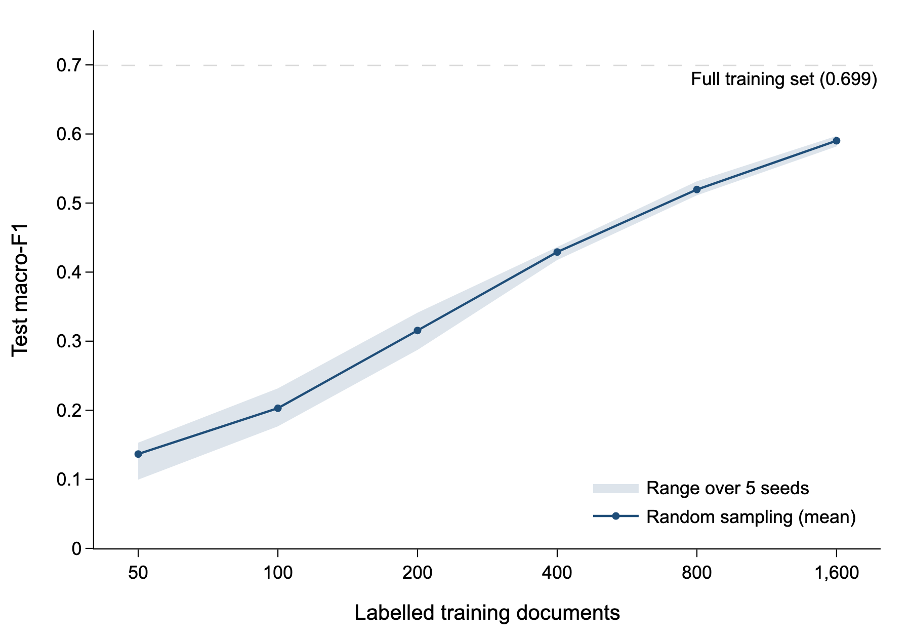

# Active learning for topic classification: how many labels does uncertainty sampling save?

> [!WARNING]
> **Work in progress.** Only the news domain (20 Newsgroups) has results so far. The uncertainty-sampling experiments, the preprocessing and model comparisons, and the paper and tweet domains are still being built. Numbers and code may change.

Labelling text is the expensive part of building a classifier. This project asks:

> **Does uncertainty sampling reach the same accuracy with fewer labels than random sampling, and does that saving hold across domains — news, academic papers and social media posts?**

The setup follows [Small-Text](https://github.com/webis-de/small-text) (Schröder et al., 2021): pool-based active learning with a TF-IDF + linear SVM classifier, compared against random sampling on learning curves of increasing label budgets.

**Hypothesis.** Both strategies converge at very small budgets (too little signal) and at large budgets (enough labels either way). In between, uncertainty sampling should sit above random, giving a larger area under the learning curve.

## Status

| Phase | Domain | Status |
|---|---|---|
| Full-data baseline | News (20 Newsgroups) | Done |
| Random-sampling learning curve | News | Done |
| Preprocessing comparison (raw / stop words removed / lemmatised) | News | Planned |
| Model comparison (Naive Bayes / logistic regression / linear SVM) | News | Planned |
| Classification demo for new documents | News | Planned |
| Uncertainty-sampling learning curve | News | In progress |
| Cross-domain replication | Papers, tweets | Planned |

## Results so far (20 Newsgroups)

**Full-data baseline** (TF-IDF + LinearSVC, all 11,014 training documents): test **macro-F1 0.699**, accuracy 0.711. The weakest classes are the three religion/atheism groups and `talk.politics.misc` (F1 0.38–0.52), which are mostly confused with each other.

**Random-sampling learning curve** (5 seeds per budget):



| Labels | Mean macro-F1 | Range over seeds |
|---|---|---|
| 50 | 0.137 | 0.099–0.153 |
| 100 | 0.203 | 0.177–0.232 |
| 200 | 0.316 | 0.287–0.341 |
| 400 | 0.429 | 0.418–0.437 |
| 800 | 0.520 | 0.511–0.532 |
| 1,600 | 0.590 | 0.582–0.597 |

With 1,600 labels (15% of the training set), random sampling already reaches 84% of the full-data macro-F1. This is the curve uncertainty sampling has to beat.

## Data: 20 Newsgroups

Loaded with `sklearn.datasets.fetch_20newsgroups` using the standard by-date split (test posts are later in time than train posts). Headers, footers and quoted replies are removed, so the model cannot read the newsgroup name or a signature instead of the text. Posts left empty after removal are dropped: they would be all-zero vectors that uncertainty sampling queries first and learns nothing from.

| | Train | Test |
|---|---|---|
| Documents | 11,014 | 7,317 |
| Dropped as empty | 300 | 215 |
| Classes | 20 | 20 |
| Median length (whitespace tokens) | 86 | 85 |
| Imbalance ratio (largest ÷ smallest class) | 1.64 | 1.60 |

Metric: **macro-F1** (every class weighted equally), with accuracy reported alongside.

## Reproduce

```bash
conda create -n nlp python=3.11
conda activate nlp
pip install -r requirements.txt

python -m src.data.newsgroups          # dataset statistics (downloads ~14 MB into data/)
python -m src.core.baseline            # full-data baseline   -> results/baseline_20ng.json
python -m src.core.random_curve        # random learning curve -> results/random_curve_20ng.csv
python experiments/plot_random_curve.py  # figure             -> figures/random_curve_20ng.{html,png}
```

All runs use fixed seeds; every number above comes from a file in `results/`.

## Repository layout

```
src/data/      dataset loading and preprocessing
src/core/      classifier, sampling strategies and active-learning loop
experiments/   plotting and experiment scripts
results/       raw outputs (CSV/JSON), one file per run
figures/       generated figures
```

## Reference

Schröder, C., Müller, L., Niekler, A., & Potthast, M. (2021). *Small-Text: Active Learning for Text Classification in Python.*
